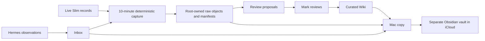

# Architecture

## Relationship to Voltron

This follows Voltron's capture → triage → review → archive workflow and Raw → Review → Wiki trust model. It reuses the filesystem-first Obsidian convention, YAML provenance and wikilinks. It installs an adapted local learning recorder with a fresh Slim-only register. It does not import the studios' data, install their Kanban gate, promote lessons automatically or train model weights.

## Storage

- Slim canonical vault: `/var/lib/slim-telemetry-vault`.
- Capture executable: `/usr/local/lib/slim-vault/capture.py`.
- Recorder state and lock: `/var/lib/slim-vault-capture`.
- Mac copy: `~/Library/Mobile Documents/com~apple~CloudDocs/slim-telemetry`.
- Mac mirror runner and receipts: `~/Library/Application Support/SlimVaultMirror`.

The Mac mirror pulls files over existing authenticated SSH every ten minutes, never uses deletion synchronization, and preserves overwritten Mac files in `.sync-conflicts/`. Neither vault is public Git content. The Mac copy is an additional device copy; iCloud synchronization is not an independently tested backup or restore guarantee.

## Captured source classes

Hermes MEMORY/USER Markdown, conversation database, cron execution/delivery/notepad databases, retained cron outputs, selected Hermes diagnostic logs, network event/alert histories, router samples/outcomes/state/cleanup ledger, selected exported metric textfiles, raw ASUS syslog and the initial preservation snapshot. SQLite databases use the SQLite backup API, not a raw copy of a live database/WAL.

Objects are gzip-compressed and addressed by the SHA-256 of their uncompressed bytes. Each timestamped manifest records source path, type, size and digest. Identical content is reused. Source deletion never triggers archive deletion. This archive does not contain the complete Prometheus TSDB, every system journal, every Pi-hole query or all system files. Their live retention remains in [[retention-register]].

Related: [[SYSTEM]] · [[runbook]] · [[source-register]]
