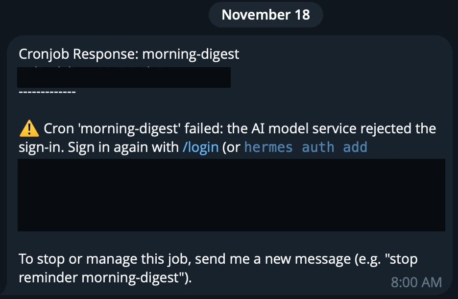
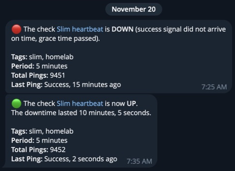
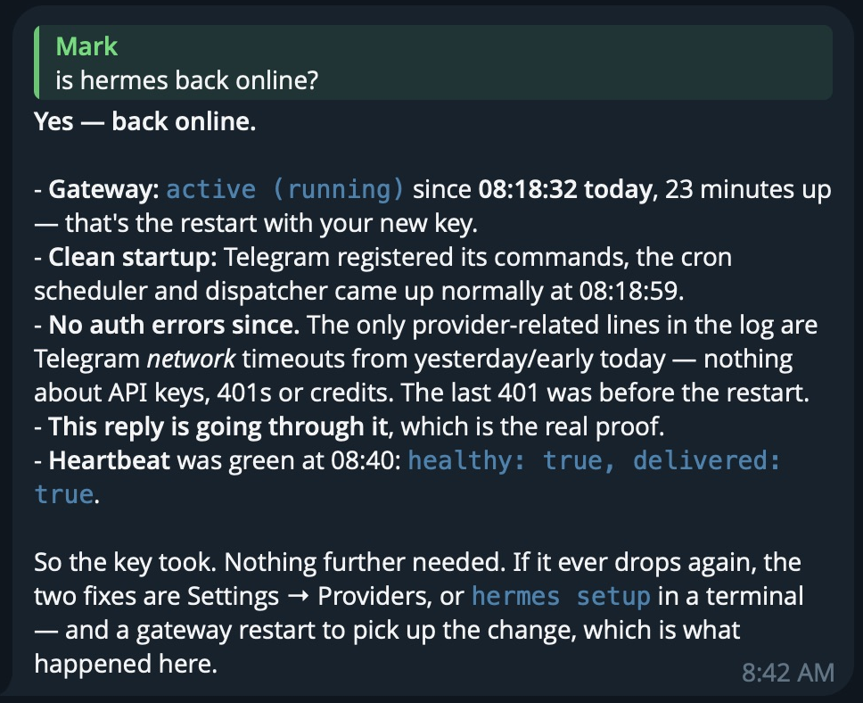
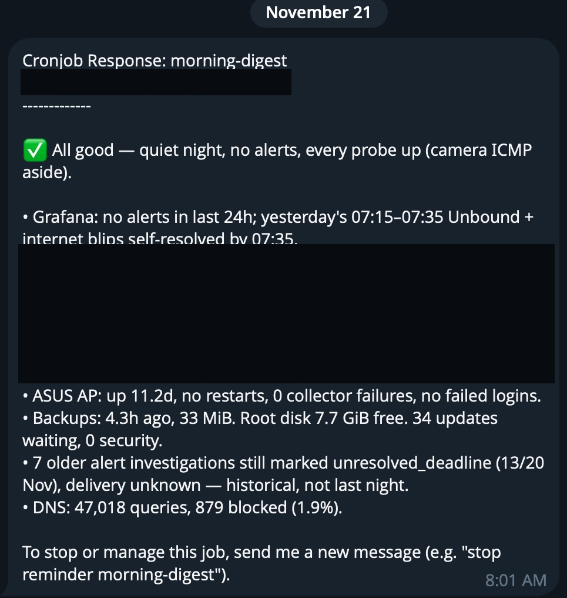

# AI-assisted monitoring during provider failure

**Mark Pierotti · Home Lab / Hermes · November 2026**

I designed Slim's monitoring so that conventional probes, alert evaluation and external heartbeat monitoring operate independently of AI-generated interpretation. In November 2026, a model-provider authentication failure stopped the morning digest, providing a real observation of the boundary between infrastructure monitoring and AI assistance.

## Failure and recovery sequence

| Date and time (AEST) | Observation |
| --- | --- |
| 18–20 Nov, 08:00 | Morning-digest cron reported three consecutive model sign-in failures. |
| 20 Nov, 07:25 | Healthchecks reported Slim's heartbeat DOWN after a success signal was overdue by 15 minutes. |
| 20 Nov, 07:35 | Healthchecks reported UP after 10m 5s in the DOWN state. |
| 20 Nov, 08:01–08:05 | The Slim bot reported an HTTP 401 indicating an expired OpenRouter API key. |
| 20 Nov, 08:18 | After credential replacement, the gateway restarted. |
| 20 Nov, 08:42 | The bot delivered a successful response and reported normal scheduler startup, no subsequent authentication errors and a green heartbeat at 08:40. |
| 21 Nov, 08:01 | The scheduled morning digest was delivered successfully again. |

### Evidence

*18 November — failure of the AI-generated morning digest is explicitly surfaced.*

*20 November — the independent heartbeat reported the outage and recovery before AI authentication was restored.*

*20 November — successful reply after restart, with scheduler and heartbeat status reported by the bot.*

*21 November — the next scheduled digest resumed. Household device details are redacted.*

## Outcome

The external heartbeat provided independent evidence during the AI service problem and recovery. Subsequent AI responses were delivered after I replaced the expired credential and restarted the gateway. The following day's digest reported 11.2 days of ASUS uptime, zero collector failures, a recent backup and 47,018 DNS queries over 24 hours, including 879 blocked queries.

The report also retained seven older investigations marked unresolved with delivery unknown. That is an important operational distinction: a recovered probe can coexist with incomplete investigation evidence. None of the observed events demonstrates automatic AI-provider failover, continuous Grafana coverage for the entire period or the cause of the 20 November heartbeat interruption.

## Implementation references

- [Home Lab architecture and deployment](https://github.com/markpierotti/home-lab)
- [External heartbeat](https://github.com/markpierotti/home-lab/blob/main/docs/slim-alerts-20261018.md)
- [Incident lifecycle and evidence persistence](https://github.com/markpierotti/home-lab/blob/main/docs/slim-remedies-20261022.md)

Evidence comprises cropped Telegram screenshots captured on 21 November from the Slim and Healthchecks bots. Internal job identifiers and household network details have been obscured.
