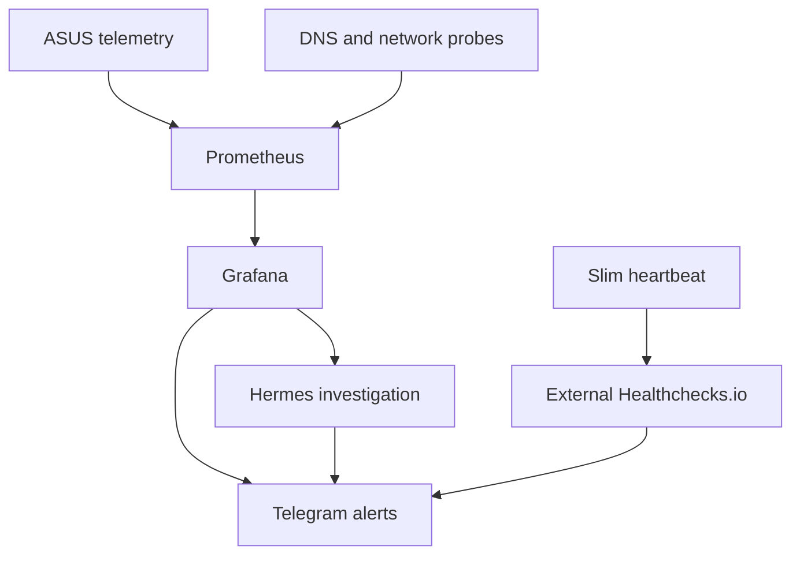
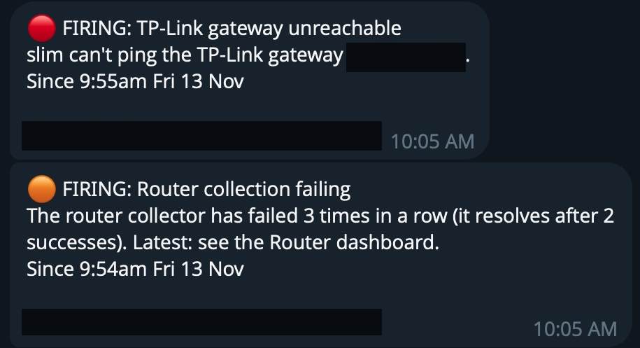
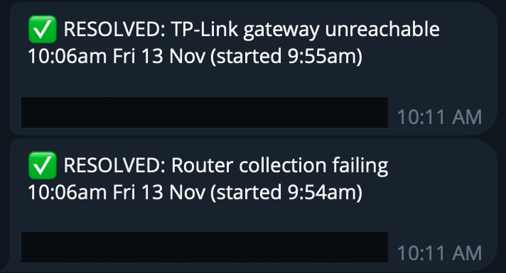
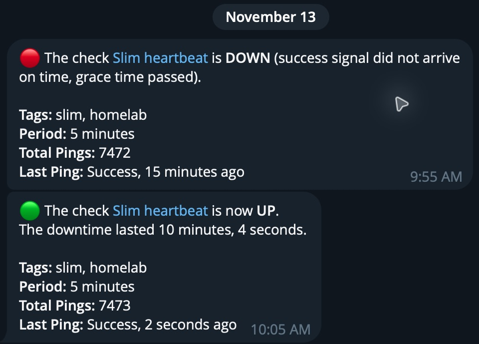
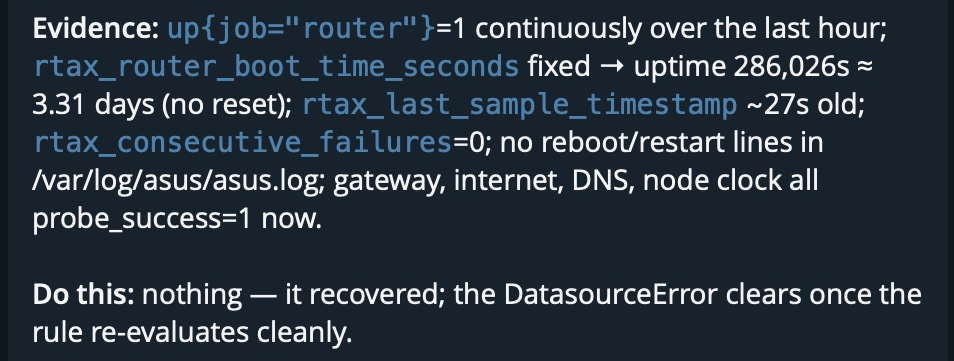

# Infrastructure maintenance and recovery

**Mark Pierotti · Home Lab / ASUS Router Telemetry · November 2026**

I built a monitoring stack on a thin client named Slim to give visibility into DNS availability, the local gateway, internet connectivity and an ASUS access point. The operational challenge is to distinguish a true network fault from the effects of maintaining the machine that observes the network.

## Architecture

The Home Lab deployment uses Pi-hole and Unbound, Prometheus, Grafana, a pinned ASUS telemetry collector, Telegram alert delivery and an independent Healthchecks.io heartbeat. Hermes receives selected alerts and produces evidence-based investigations and a daily summary. The external heartbeat independently detects missing success signals when Slim cannot report its own health.

## Incident timeline

On 13 November, Slim's morning digest reported an installed kernel update requiring a restart. Later that morning, services became unavailable during maintenance. Telegram preserved both local alert transitions and the external watchdog's independent observation.

| Time (AEST) | Observation |
| --- | --- |
| 09:43–10:04 | The following day's digest reported several clean systemd poweroffs and a boot at 10:04. |
| 09:54–09:55 | Grafana recorded router collection failure and gateway unreachability. |
| 09:55 | Healthchecks reported a missed heartbeat after the grace interval. |
| 10:05 | Grafana firing messages arrived. The external heartbeat reported recovery at approximately 10:05, with 10m 4s in the DOWN state. |
| 10:06–10:11 | Gateway and router collection alerts resolved at 10:06; their Telegram resolution notifications arrived at 10:11. |
| 10:07 | Hermes reported fresh router telemetry, zero consecutive collector failures and no corroborating router restart evidence. |

### Evidence

*13 November, 10:05 — two separate firing notifications, delivered with recorded onset times.*

*13 November, 10:11 — both alerts resolved, with 10:06 as the recorded resolution time.*

*13 November, 09:55–10:05 — the independent heartbeat monitor reported a 10-minute, 4-second DOWN interval.*

*13 November — Hermes reported evidence from Prometheus and router logs, distinguishing a data-source evaluation error from a router reboot.*

*14 November, 08:01 — the retrospective digest attributed the alert burst to planned host maintenance, citing the host journal.*

## Result and engineering lessons

The notifications provide an observed recovery sequence across multiple monitoring layers. The ASUS collector had a temporary collection failure, then returned to zero consecutive failures. The investigation reported approximately 3.31 days of continuous router uptime and a sample approximately 27 seconds old, which argues against a router restart during the Slim maintenance window.

Previously, an ASUS boot timestamp shift had triggered a misleading reboot alert. The Home Lab Grafana rule now uses corroborated uptime decreases and distinguishes missing telemetry from restart evidence. The upstream collector's own CPU-derivation reboot classification is a separate outstanding correction.

The case demonstrates incident correlation, alert lifecycle verification and the importance of independent monitoring for the monitoring host itself. The bot's retrospective diagnosis is a reported interpretation of the journal, and the incident is a planned maintenance observation. It does not establish controlled power-loss recovery or full disaster-recovery readiness.

## Implementation references

- [Home Lab deployment](https://github.com/markpierotti/home-lab)
- [ASUS Router Telemetry](https://github.com/markpierotti/asus-router-telemetry)
- [Alert and heartbeat deployment](https://github.com/markpierotti/home-lab/blob/main/docs/slim-alerts-20261018.md)
- [Incident remedies and validation](https://github.com/markpierotti/home-lab/blob/main/docs/slim-remedies-20261022.md)
- [Live-state documentation reconciliation](https://github.com/markpierotti/home-lab/pull/6)

Evidence comprises cropped Telegram captures taken on 21 November 2026. Local addresses, operational links and job identifiers have been obscured.
