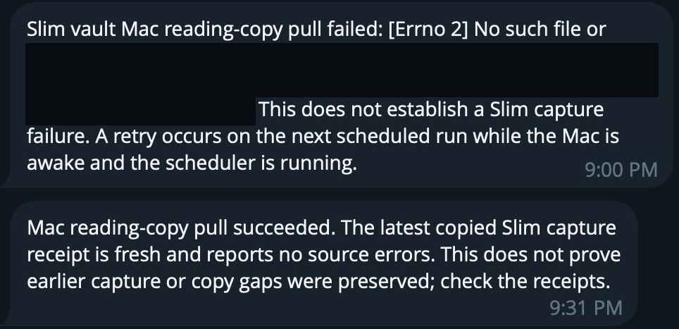

# Telemetry evidence preservation and mirror recovery

**Mark Pierotti · Home Lab / Voltron · November 2026**

Short-lived logs, alert histories and operational records are easy to lose as services rotate or prune their data. I introduced a filesystem-first evidence vault on Slim to preserve selected operational records and make a separate reading copy available on my Mac.

## Design

- Slim captures selected sources every ten minutes, retaining hashed, compressed objects and consistent snapshots of selected SQLite databases.
- A one-way Mac mirror pulls the reading copy, retains overwritten local files and does not propagate deletion from the source.
- Hermes reads evidence and writes scoped investigation notes. Raw capture ownership and curated operational memory have separate permissions.
- Capture and mirroring make zero model calls. Storage guards and receipt checks surface failures.

The external reading copy is useful for reviewing operational history across devices. Captures and mirrors are bounded by their source coverage and run status.

## Observed failure

On 16 November at 21:00 AEST, the Mac reading-copy pull reported a missing local capture file. Its notification explained the distinction between a failed copy and a failed capture on Slim. The scheduled retry at 21:31 reported a fresh copied receipt with no source errors.

*16 November — Telegram records a local file-not-found failure and a successful pull 31 minutes later. The local filesystem path has been redacted.*

The next successful receipt establishes that the later mirror operation returned fresh data. It does not prove that every earlier capture was preserved, and the bot explicitly retained that uncertainty. The same pattern appeared on 11 November and later successful-copy notifications continued after 16 November.

## Outcome and trade-offs

The failure was visible and the scheduled mechanism recovered without requiring an AI-generated interpretation. A future investigation should compare source and replica receipt sequences to determine whether any gaps remain. The cause of the missing local file was not established by these messages.

I treat the mirror as a reading copy. Full backup and service-restoration validation are separate exercises. On 13 November, an independent off-host backup pull was repaired and all 14 available archives passed compression checks; extracted Pi-hole and Grafana databases passed SQLite integrity checks. Full host recovery remains outstanding.

## Implementation references

- [Slim telemetry vault architecture](https://github.com/markpierotti/home-lab/blob/main/deploy/slim-vault/README.md)
- [Backup validation](https://github.com/markpierotti/home-lab/blob/main/docs/slim-backup-validation-20261113.md)
- [Home Lab evidence vault and operational documentation PR](https://github.com/markpierotti/home-lab/pull/5)

Evidence is a cropped Telegram capture taken on 21 November 2026. The screenshot of the failure and retry is genuine; the local path is obscured.
