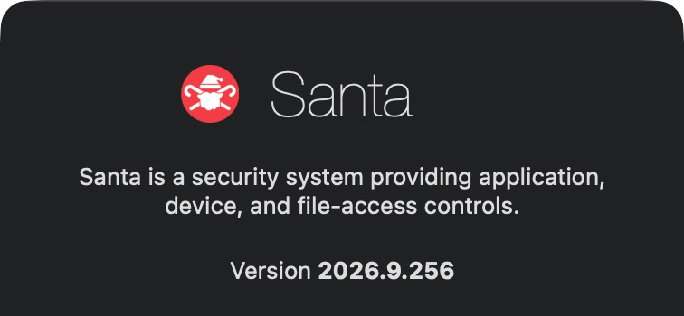
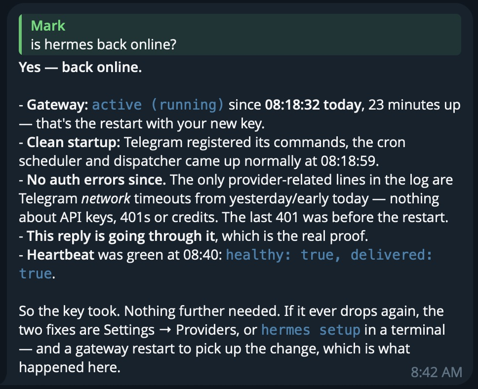

# Workstation security incident recovery and hardening

**Mark Pierotti · Home Lab · November 2026**

In November 2026, I downloaded a file that I identified as malware. I treated the Mac as potentially compromised and chose to rebuild it from a clean macOS installation. I changed passwords and rotated API keys as part of the recovery, then installed additional endpoint-security tooling.

This case study records my response and the observed restoration of monitoring and operational tooling. My account of the download and credential rotation is the incident context. I have not independently established the malware family, execution outcome, or whether credentials were actually accessed.

## Recovery milestones

| Date | Action and evidence |
| --- | --- |
| 11 November | I completed a clean macOS Tahoe installation. The Hermes integrity monitor was paused during the rebuild, as recorded in the subsequent pipeline review. |
| 13 November | I restored the restricted off-host Slim backup pull. A loop-input defect was corrected, all 14 available archives passed compression checks, and two extracted SQLite databases passed integrity checks. |
| 16 November | The Mac telemetry reading-copy pull reported a file-not-found error and recovered on a scheduled retry at 21:31. |
| 18–20 November | Slim reported three consecutive provider sign-in failures; the bot subsequently reported an expired API key. |
| 20 November | I replaced the expired key and restarted the gateway. A successful response and the following day's morning digest demonstrated resumed AI-assisted reporting. |
| 21 November | I inspected the installed Santa and LuLu applications. Their version dialogs provided the evidence below. |

The provider authentication failures occurred during the broader recovery period. The available messages establish expiry and subsequent restoration; they do not establish a causal link to the malware download.

## Endpoint security

I installed [Santa](https://northpole.dev/) for macOS application execution visibility and control, and [LuLu](https://objective-see.org/products/lulu.html) for outbound application connection visibility and control. I prepared a local Santa configuration using monitor mode to observe execution events before making further policy decisions.

*21 November — Santa's installed application version dialog.*

*21 November — LuLu's installed application version dialog.*

I verified the installed application versions and the local monitor-mode profile. I still need a privileged effectiveness check to establish the state of the endpoint services and their applied policy. The status check available during this review could not communicate with the Santa daemon.

## Operational recovery evidence

*20 November — AI-assisted reporting resumed after credential replacement and gateway restart.*

I also preserved the separation between the Mac reading copy and Slim's canonical evidence vault. The independent heartbeat continued to provide observable availability signals during model-provider failures.

## Outcome

I used the incident to improve my workstation security posture and to understand the operational dependencies affected by a rebuild. I am building a defensive security operations capability for my own systems, motivated by the need to detect and investigate suspicious activity and reduce the likelihood and impact of another compromise. The experience demonstrated the value of repeatable recovery procedures, independent service monitoring, credential rotation, and explicit verification of restored functionality.

My next steps are to validate endpoint-control effectiveness, centralise endpoint and network telemetry, and review the integrity and learning monitor schedules affected by the rebuild. I intend to measure those capabilities using documented defensive acceptance checks before claiming operational coverage.

## Related records

- [Backup validation on 13 November](../slim-backup-validation-20261113.md)
- [AI-assisted monitoring during provider failure](ai-provider-failure-and-recovery.md)
- [Telemetry evidence preservation and mirror recovery](telemetry-vault-retry-and-recovery.md)

The screenshots were captured on 21 November 2026. Credential values and private endpoint configurations are excluded.
