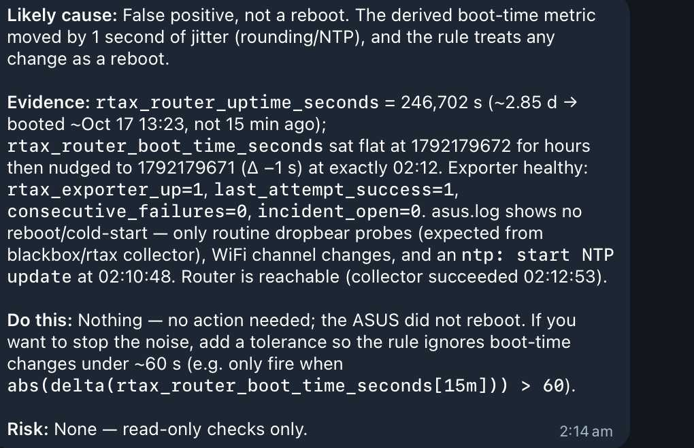

# ASUS reboot alert: likely false positive — 20 October 2026

**Assessment:** the available evidence supports a false reboot alert triggered by a
one-second change in the derived boot-time metric. The device named in the alert
was the ASUS RT-AX56U, not Slim. The notification resolved without a reported restart
or configuration change. Alert sensitivity remains an open follow-up.

**Follow-up:** the [20–21 October operational evidence](20261021-slim-follow-up.md)
adds recurring alerts, failed evidence writes, an investigation-budget warning and
the 20 October camera investigation, with proposed remedies linked to PR #3.
Those remedies remain untested and undeployed; this original record is preserved.

This record uses the owner's Telegram screenshot, captured at 05:52 on 20 October,
and an inspection of the repository alert source. The bot's historical metric and
router-log observations below have **not been independently replayed**. Times are
interpreted as AEST (Australia/Brisbane), the owner's timezone; the screenshot itself
does not print a timezone.

## Timeline shown or reported

| Time | Event | Evidence |
| --- | --- | --- |
| 02:10:48 | Router NTP update reportedly started. | Bot's account of `asus.log`; raw log not attached. |
| 02:12 | `ASUS router rebooted` entered Firing; message says boot identity changed within 15 minutes. | Alert notification. |
| 02:12:53 | Collector reportedly succeeded; router remained reachable. | Bot diagnosis. |
| 02:14 | Bot diagnosed a false positive and proposed adding a tolerance. | Bot message timestamp. |
| 02:26 | Alert's resolved timestamp. | Resolved notification. |
| 02:27 | Resolved notification displayed as received. | Telegram message timestamp in original screenshot. |

## Reported evidence and its limits

The bot reported:

- `rtax_router_uptime_seconds = 246702` (approximately 2.855 days), inconsistent with
  a reboot in the preceding 15 minutes.
- `rtax_router_boot_time_seconds` changed from `1792179672` to `1792179671`, a
  **minus-one-second** change, after remaining constant for hours.
- Exporter health was `rtax_exporter_up=1`; its shorthand values were
  `last_attempt_success=1`, `consecutive_failures=0`, `incident_open=0`.
- No reboot/cold-start signature in the inspected ASUS log; routine SSH probes,
  Wi-Fi channel activity and the NTP update were present.

**Correction to the bot's arithmetic:** epoch `1792179672` converts to
**17 October 2026, 05:41:12 AEST**; `1792179671` is 05:41:11. The bot's “Oct 17
13:23” conversion is inconsistent with those numbers. The crops preserve that
original error rather than rewriting the evidence. The reported uptime also places
the boot several days earlier, but its precise sampling time is not supplied.

The NTP event is correlated in time. Rounding or clock adjustment is a plausible
explanation for the one-second shift, **not a demonstrated root cause**. The screenshot
alone cannot prove complete continuity or exclude every router fault.

A separate read-only check of Slim around 05:51 showed its last boot at **17 October,
05:07 AEST**, supported by system uptime and journal boot history. That establishes
no overnight Slim reboot in those records; it does not validate the ASUS observations.
No new host access was needed to prepare this documentation.

## Alert source observation

The checked-in [`router-rebooted` rule](../../deploy/slim/etc/grafana/provisioning/alerting/slim-rules.yaml)
evaluates:

```promql
changes(rtax_router_boot_time_seconds[15m])
```

Its threshold is greater than zero, with `for: 0s`. Thus even a one-second change
can satisfy the condition. Its annotation states that the router rebooted, which
is stronger than the metric change alone establishes. This is a source inspection,
not verification of the exact rule deployed at 02:12.

## Follow-up: open, not deployed

Review reboot detection to distinguish clock/rounding jitter from a real restart.
Compare a boot-time tolerance with evidence of an uptime reset, and retain explicit
handling of stale, missing and unhealthy exporter data. Validate small positive and
negative time shifts, real reboots, scrape gaps and exporter outages before changing
source or deploying a revised rule. Define how to roll back that change.

The bot's `abs(delta(...)) > 60` expression visible below is an **untested proposal**,
not an approved replacement. Its threshold and range behavior need evaluation; an
absolute change is not itself proof of a reboot. No alert, exporter or collector
code was changed for this record, and no reboot was induced.

## Screenshot evidence

These three rectangular crops retain the original pixels and text without rewriting,
resizing or generative editing. The private Grafana links and surrounding chat chrome
are excluded by cropping. The original screenshot remains private. Crop coordinates
and SHA-256 hashes are in the [evidence manifest](assets/20261020-asus-false-reboot/manifest.json).

### Firing notification


### Bot diagnosis — claims and untested proposal

The diagnosis contains the incorrect boot-time conversion noted above and an untested
PromQL suggestion. Preserve it as a record of what the bot said, not as verified guidance.



### Resolved notification


