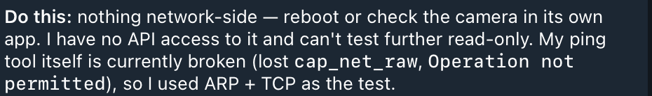
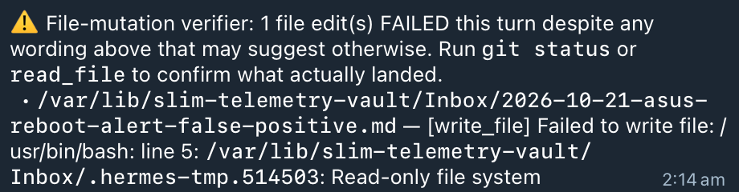
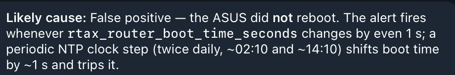
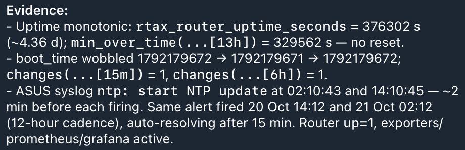
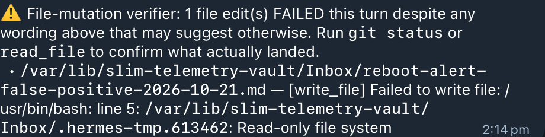

# Slim follow-up: recurring ASUS alerts and failed evidence writes

**Assessment:** the screenshots add two 21 October ASUS reboot-alert cycles, two
explicit evidence-write failure diagnostics, and an investigation-budget warning.
They also record a camera investigation on **20 October**, as clarified by the owner.
The reboot diagnoses remain consistent with a likely false positive; neither the
automatic resolutions nor the bot's confidence establishes a repair.

This extends the [20 October record](20261020-asus-false-reboot.md) without replacing
it. It documents four separate operational concerns; no common root cause has been
demonstrated. **All remedies below are proposed, untested and undeployed.** This
update changes documentation only and leaves the existing read-only authority intact.

## Evidence and provenance

Three owner-provided Telegram screenshots were captured on **22 October 2026 at
05:45:34, 05:46:15 and 05:46:32**. Capture time is distinct from event time. Times
below are interpreted as AEST (Australia/Brisbane); the images do not print a timezone.
The camera exchange precedes the “21 October” divider; its 20 October date is owner
clarification, not a printed date in that exchange.

The [manifest](assets/20261021-slim-follow-up/manifest.json) identifies each private
source by SHA-256, dimensions and capture time, and records the coordinates and
hash of every public crop. Crops preserve original pixel values without resizing,
overlays or generative editing. They exclude private endpoints, MAC addresses,
household inventory, query history and private commands. Originals remain private.
Where a safe rectangle cannot retain the relevant passage, a separately labelled
[redacted transcription](assets/20261021-slim-follow-up/redacted-transcriptions.md)
preserves selected text and marks omissions. Crop boundaries omit some message
timestamps; those are identified in that transcription.

## Timeline

| Event time | Observation | Evidence and limit |
| --- | --- | --- |
| 20 Oct, 18:58–19:00 | Owner reports camera offline; bot reports reachability, refused TCP ports, absent monitoring and unavailable direct ping. | S1; date confirmed by owner. No independent device or monitoring check in this update. |
| 21 Oct, 02:12 | `ASUS router rebooted` fires. | S1 notification. Names ASUS, not Slim. |
| 02:14 | Bot diagnoses likely false positive; file-mutation verifier reports failed Inbox write with `Read-only file system`. | S1 diagnosis and S2 diagnostic. No successful archive receipt shown. |
| 02:26 / 02:27 | Notification says resolved at 02:26; Telegram shows receipt at 02:27. | S2. Resolution does not establish a detector fix. |
| 08:00 | Morning digest calls earlier alerts false positives and says the router booted 16 October. | S2; conflicts with other messages' boot epoch/date. Unrelated household details excluded. |
| 14:12 | Same ASUS alert fires again. | S2 notification. |
| 14:14 | `Iteration budget exhausted (15/15)` warning; bot produces a diagnosis; second Inbox write fails. | S2 warning/diagnosis and S3 diagnostic. A summary exists despite budget exhaustion. |
| 14:26 / 14:27 | Afternoon alert resolves at 14:26; received at 14:27. | S3. No confirmed implementation or deployment. |

## Findings and limits

### Reboot detection and inconsistent reasoning

The morning bot reports uptime **333102 seconds** (3.855 days), boot epoch
**1792179672**, a one-second boot-time shift and one `cpu_util_state=reboot` sample.
The afternoon report gives uptime **376302 seconds** (4.355 days), a 13-hour minimum
of **329562 seconds**, and boot-time values **1792179672 → 1792179671 → 1792179672**.
It reports NTP updates at 02:10:43 and 14:10:45, shortly before the alerts.
These metric and log observations are **bot claims, not independently replayed data**.
A range minimum alone does not prove uninterrupted uptime or exclude every reset.

The checked-in [rule](../../deploy/slim/etc/grafana/provisioning/alerting/slim-rules.yaml)
at this PR's baseline `fdf9892a` uses `changes(rtax_router_boot_time_seconds[15m])`,
threshold greater than zero and `for: 0s`. A one-second shift can satisfy that source
condition. The installed rule at either event time was not exported or reconciled.
NTP is a temporal correlation and plausible contributor, **not a proven cause**.

Epoch `1792179672` is **17 October 2026, 05:41:12 AEST**, as corrected in the earlier
record. The digest's “booted 16 Oct” conflicts with that value; do not promote the
digest to a verified boot history. The morning suggestion
`delta(rtax_router_boot_time_seconds[15m]) > 300` is **not an accepted fix**: it is
directional, a range delta is not proof of a restart, and the threshold has no
validated detection contract. Uptime-reset corroboration is also a candidate
requiring freshness, collection-health and counter-behaviour validation.

### Evidence writes fail; host-wide read-only status is unproven

Both file-mutation diagnostics report one failed file edit in the vault Inbox.
The afternoon bot additionally says “root fs mounted ro”. No host mount evidence
is attached. The [checked-in gateway sandbox](../../deploy/slim/etc/systemd/system/hermes-gateway.service.d/hardening.conf)
uses `ProtectSystem=strict` with write paths limited to Hermes home/runtime; the
vault Inbox is not listed. This makes service-namespace restrictions a plausible
explanation, but does not establish the effective deployed permissions or mount state.
Ordinary file permissions also require inspection before selecting a change.

### The investigation reaches its budget

The visible warning establishes that the afternoon run reached 15/15 iterations;
it does not prove that the follow-up was entirely lost, since a diagnosis follows.
The [configuration example](../../deploy/slim/hermes/config.overlay.yaml) sets
`max_turns: 15`; installed configuration was not read. Increasing that limit alone
would leave duplicate work and persistence failures unresolved. Completion,
evidence storage and notification delivery need separate outcomes.

### Camera availability and ping coverage are different questions

The bot reports a reachable ARP neighbour, TCP refusals on all five tested ports,
no camera monitoring, and a direct-ping `Operation not permitted` error. Those are
reported observations, not an independent identity/availability test. Even if
confirmed, they do not establish application health or a cloud-service fault.
No Pi-hole queries would not, by itself, establish whether a camera uses fixed
addresses, another resolver or encrypted DNS.

A TCP probe needs an identity-confirmed endpoint known to accept the connection
while healthy; the five refused ports cannot yet supply that contract. The sandbox's
empty capability set and `NoNewPrivileges=yes` are relevant to direct ping, but
the exact execution path and kernel ping permissions remain unverified. Existing
monitored probe results should be the first diagnostic input; broad capabilities
for the model process are not the proposed remedy.

## Proposed remedies and acceptance

These work items feed the existing [operations planning PR #3](https://github.com/markpierotti/home-lab/pull/3),
specifically its [coverage review](https://github.com/markpierotti/home-lab/blob/docs/operations-team-plan-20261020/docs/plans/operations-coverage-20261020.md)
and [phased plan](https://github.com/markpierotti/home-lab/blob/docs/operations-team-plan-20261020/docs/plans/autonomous-operations-20261020.md).
That PR remains the shared implementation plan. This record adds incident evidence
and acceptance requirements, not a second repair programme. Its reviewed head was
`dd7ee4ce`; cross-branch links point to the ongoing plan.

| Work item / owner | Finding and evidence | Proposed change | Future acceptance evidence | Status |
| --- | --- | --- | --- | --- |
| R1 — Observability | Recurring cycles; S1/S2 diagnoses and source rule. | Define reboot detection using corroborated restart evidence and explicit freshness/health guards; choose an expression after validation. | ±1-second jitter never becomes a reboot; genuine reset scenarios detected; gaps, missing/stale series and exporter/collector failures produce explicit uncertainty. Include short prior uptime and clock steps. | Proposed; untested; undeployed. |
| R2 — Systems + Platform | Two failed writes; S2/S3 diagnostics. | Reconcile effective service namespace and directory permissions; provide only a narrowly writable incident Inbox or a supported scoped writer. Retain a recoverable private fallback and report failed persistence explicitly. | Allowed writes have a durable receipt and survive worker restart; denied paths stay denied; storage-full/write-denied cases retain a recoverable result and expose failure. No false claim of successful storage. | Proposed; untested; undeployed. |
| R3 — Operations lead + Platform | Repeated investigation and 15/15 warning; S1–S3. | Correlate events with the existing incident, preserve each event reference, use a bounded deterministic evidence bundle, and emit a partial summary at the deadline. Keep completion/storage/delivery receipts separate. | Duplicate/repeated events reuse evidence without losing new facts; budget exhaustion yields an explicit partial result; failed writes, interrupted work and delivery failure remain unresolved until evidenced. | Proposed; untested; undeployed. |
| R4 — Network + application owner | Camera offline report and missing coverage; S1. | Confirm device identity, measure a working health signal, and define separate network and application checks before proposing an alert. | Healthy baseline succeeds; network-unreachable and application-unhealthy cases are distinct; refused ports cannot report healthy service. Unsupported cloud/API checks remain unknown. | Proposed; untested; undeployed. |
| R5 — Systems + Observability | Direct ping denied; S1 and sandbox source. | Use existing authorised monitored probes; reconcile direct-ping permissions before considering any narrowly scoped probe change. | Probe success/failure/staleness/absence are distinguished; permission errors are explicit tool failures; model process retains its privilege boundary. | Proposed; untested; undeployed. |

Sequence: reconcile deployed metadata first (PR #3 phase 0); validate R1's detector
and R2's storage contract; integrate R3 with the existing durable-intake work; define
R4/R5 coverage from measured signals. Runtime work belongs in separate implementation
PRs with actual results recorded there. No outage, restart or new scheduled/model
job is authorised or executed by this evidence update.

Each implementation needs a rollback: **R1**, restore the saved rule revision and
verify provisioning; **R2**, restore prior unit/permissions after preserving queued
evidence; **R3**, disable the new intake/retry path and restore the previous handler
while retaining pending records; **R4**, remove the new target/rule and verify existing
monitoring; **R5**, restore the previous scoped probe configuration/permissions.
For every rollback, verify restored behaviour and record remaining limitations.

## Screenshot crops

Bot conclusions and commands visible in crops are historical evidence, not endorsed
instructions. The following selected regions omit private material; use the
manifest and transcriptions for source context.

### Camera investigation — 20 October

### Morning alert and failed write — 21 October

The diagnosis is available as a redacted transcription above because it includes
private target details.

### Digest inconsistency — 21 October, 08:00

The crop preserves the conflicting “booted 16 Oct” claim; it is not verified history.

### Afternoon recurrence, budget and failed write — 21 October

