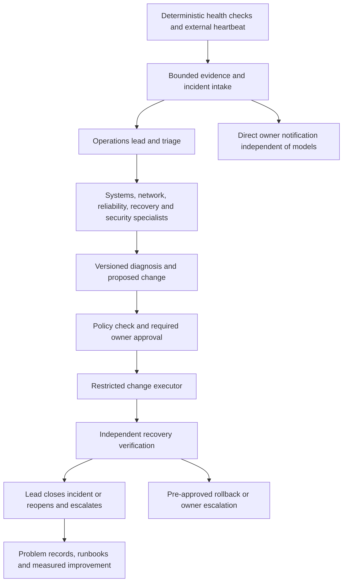

# Autonomous operations team — proposed design, 20 October 2026

Build a coordinated operations team for the whole home lab: systems administration,
network engineering, service reliability, backups, applications and security. The
owner sets policy; specialists diagnose and propose changes; a restricted executor
performs only authorised actions; an independent verifier checks recovery. Routine
health assessment continues without model access.

**Revision after owner-supplied Argon and Claude reviews:** start with one operator
and domain playbooks; retain the full professional responsibility catalogue as the
long-term scope. See the [review dispositions](../reviews/operations-plan-disposition-20261020.md).

**Status:** implementation plan only. No new profiles, privileges, repairs, schedules
or model jobs are deployed by this document. The existing read-only operator and
empty restart allowlist remain the current authority. The
[coverage review](operations-coverage-20261020.md) identifies observed evidence,
source gaps and protected live configuration that still needs reconciliation.

## Operating model

Health collection, reasoning and execution are separate capabilities. A profile
names a role and context; **it is not a permission boundary**. OS identities,
service sandboxing, approved tools and a restricted action interface enforce
permissions. Creating multiple profiles under one powerful account would not
provide separation of duties.

Reuse the existing Prometheus/Grafana, systemd, Hermes profiles/role skills,
webhook and external heartbeat components. Verify supported APIs on Slim's actual
installed Hermes version before choosing routing or scheduler integrations. Do
not assume features available on the development Mac exist on Slim, mutate
scheduler databases directly, or introduce another competing board/control plane.

## Professional roles and ownership

These are logical responsibilities. Specialists run on demand; they are not sixteen
permanent model processes. Each service has one accountable owner in a catalogue that records dependencies,
maintenance, recovery and privacy information. Mark remains the sole human approver
until a deputy is actually appointed.

| Professional role | Owns and investigates | Outputs and handoff |
| --- | --- | --- |
| Operations lead / incident commander | Owner intake, impact/severity, priority, coordination, status and escalation across disciplines. | One incident owner, evidence requests, specialist routing and one concise owner update. Does not self-approve high-impact changes. |
| NOC / service-desk triage | Initial health assessment, duplicate grouping, maintenance awareness and scope of impact. | Working/failed/unknown dependencies; suspected domain; routes to systems, networking, reliability or security. Existing operator can initially perform this function. |
| Observability / SRE engineer | Checks, exporters, alert semantics, SLOs, freshness, noise budgets and monitoring the automation itself. | Reproducible detections, graded degradation, detector regression cases and end-to-end delivery evidence. |
| Linux systems administrator | OS, systemd services, time synchronisation, packages, resource pressure and host configuration. | Host diagnosis and scoped maintenance plan; consults networking for reachability, security for patch risk and recovery for rollback. |
| Network engineer | Gateway, switching, routing, DHCP, wired links, WAN and network dependencies. | Layered reachability evidence and a network change proposal. Preserves gateway reachability and device restrictions. |
| Wireless engineer | Radio/channel behaviour, interference hypotheses, roaming, association and client experience. | Per-radio baselines and symptom correlation; channel changes require explicit maintenance approval. Wired probes are not Wi-Fi validation. |
| DNS / naming engineer | Pi-hole, Unbound, DNSSEC, caching, resolver latency and name-resolution dependencies. | Safe fixed-name probes and resolver diagnosis; no automatic upstream substitution, filtering bypass or bulk query-history access. |
| SOC analyst / incident responder | Authentication anomalies, unknown-device evidence, suspicious events and potential compromise. | Security assessment, preservation/escalation plan and authorised containment proposal; no automatic scanning or device isolation. |
| Security / vulnerability engineer | Exposure, supported versions, advisories, patch prioritisation and hardening proposals. | Evidence-backed remediation backlog, reviewed patch plan and accepted/deferred risk. Service owners assess disruption. |
| Identity / secrets administrator | Accounts, least privilege, credential lifecycle and approval trust. | Access reviews and scoped rotation/revocation plans. Credentials are not shared through agent context or incident records. |
| Storage / backup / recovery engineer | Log budgets, backup success, off-host copies, retention, data integrity and restoration. | Restore-point evidence, verified copy metadata and rehearsed recovery plan; archive creation alone does not prove recovery. |
| Platform / application engineer | Hermes runtime, Grafana, automation code, exporters and application integrations. | Versioned fixes, compatibility evidence and migration/deployment plans; consults service owners and preserves data. |
| Change / release engineer | Approved revision, rollout preconditions, maintenance windows, configuration drift and rollback. | Immutable change package bound to environment and approval; submits it to the restricted executor. |
| Independent QA / recovery verifier | Acceptance criteria, post-change function, regression, dependency impact and rollback outcomes. | Fresh evidence tied to the actual revision/action. Cannot certify a change merely from executor exit status or a copied old pass. |
| Problem / knowledge manager | Repeated incidents, root-cause records, corrected bot claims, runbooks and lessons. | Reviewed known-error records and preventive work, with provenance and expiry; hypotheses do not become facts by repetition. |
| Capacity / cost engineer | Disk/log growth, CPU/RAM headroom, model-call budgets and capacity forecasts. | Measured budgets and scaling options; unknown time/cost is unknown, not zero. Stops ineffective agent loops. |

Mark is the service owner and policy/approval authority. Automated roles can request
a decision with a concrete plan; they cannot manufacture owner approval. Security
and operations share incidents rather than maintaining conflicting status records.

## Initial runtime and enforceable ownership

Begin with **one existing read-only operator profile**, performing lead/triage and
loading versioned systems, network/wireless/DNS, recovery, security, platform and
reliability playbooks on demand. The responsibility catalogue remains intact; a
role is useful expertise and accountability even when it is not a separate process.
Do not deploy the earlier fixed six-specialist profile rollout. Additional profiles
are optional later, justified by measured workload, context quality or distinct
access requirements and supported runtime routing. Do not enable delegation now.

Use deterministic checks and verifiers for measurable acceptance. Another model
can critique a diagnosis later; a second profile under the same UID is not a
protected verification or approval authority. Protected code, evidence and action
permissions must have named owners before any new automation is activated.

| Component | Proposed enforceable ownership | Capability and limits |
| --- | --- | --- |
| Sensors and verifier | Root-owned deployed code; existing service accounts or a dedicated `opsmon` identity with only necessary read access. | Bounded read-only checks; its state/output is not writable by `hermes`. Avoid root where ordinary permissions suffice; privileged metadata readers require a separate reviewed scope. Verification is independent of the operator/executor's writable state, not proof against a compromised host. |
| Model operator | Existing `hermes` UID and sandbox; no sudo or privileged execution endpoint initially. | Narrative triage and domain playbooks. Its writable home/history is not an authoritative approval or trusted sensor store. |
| Policy and executable runbooks | Root/operator-controlled deployment outside model-writable parents, or reviewed read-only mounts. | File ownership alone inside a model-writable parent is insufficient; validate replacement/rename and alternate-path behavior. Keep necessary session/runtime state writable separately. |
| Owner maintenance | Mark's existing authenticated SSH and reviewed repository workflow. | Initially the only production change path. The model cites reviewed runbook/action IDs; a new privileged command requires review before it becomes a phone copy/paste instruction. |
| Future executor | Separate restricted service, independently approved action catalogue and owner-controlled approval store. | Not part of the first milestone. No unrestricted shell, agent-written approval or blanket service restart permission. |

The present sandbox protects system writes but permits writes in the Hermes home.
The reviewed drop-in does not enforce a LAN destination allowlist. An empty Hermes
`command_allowlist` is not a deny-all terminal policy. Explicit egress constraints,
read-only code paths and additional identities are future reviewed changes, with
DNS/provider/notification dependencies tested before activation. None are silently
assumed to exist today.

## Evidence, handoffs and incident state

Use one incident store/status writer, initially the existing operator and supported
Hermes task/execution interfaces where verified on Slim. Sensors submit events;
the lead coordinates state transitions through a supported API with revision/concurrency checks; workers
submit scoped evidence/results. Do not have agents rewrite one another's JSON or
create competing incident boards for the same project. Integrate with the owner's chosen
incident/task store through its supported interface; choose it after reviewing the existing Hermes and
workspace tooling, before implementing a new incident backend. Prefer an existing on-Slim operations board through supported APIs if its claims/recovery semantics meet the requirements.
The incident/task store is coordination state, never an approval trust anchor.

An incident must include:

- Stable ID/fingerprint, affected services/assets, dependency context, severity,
  maintenance state, owner and current assignment.
- Observed time, source, scrape/sample freshness, relevant boot ID and clock quality.
  Preserve observed versus inferred facts and bounded evidence references/hashes.
- Detection/acceptance criteria and explicit missing/error/partial states. Never
  interpret an unreadable file, failed command or missing metric as healthy/no events.
- Diagnosis, alternative explanations, confidence, evidence requests and decision log.
- Proposed action ID, exact target/parameters, source revision/configuration hash,
  impact, preconditions, approval requirement, rollback and recovery checks.
- Dispatch/claim/start/finish receipts, retry count and lease, review/approval identity,
  actual applied revision, verification result and notification-delivery outcome.
- Elapsed time/cost when measured, repeated failures, operator intervention and lessons.

Normal progression: detected → triaged → investigating → proposed → awaiting
approval (when required) → executing → verifying → resolved → closed. Observation-only
incidents may resolve without repair. Keep explicit blocked, unknown, delivery-failed,
verification-failed, rolled-back and reopened outcomes; a workflow must not force a
success merely to reach its final step. Evidence changes invalidate stale conclusions.

Deduplicate related events but retain every source event reference. Correlation
suggests a shared cause; it does not prove one. Assign one lead across DNS, WAN and
host incidents to avoid specialists issuing competing fixes to the same dependency.

## Autonomy and execution policy

| Level | Autonomous capability | Approval boundary |
| --- | --- | --- |
| Observe | Approved passive metrics/log/status queries, fixed safe probes, dedupe, evidence and owner summaries. | Default starting mode. No subnet scans, private DNS-history access or configuration writes. |
| Diagnose and prepare | Route bounded specialist work; reproduce with fixtures; prepare reviewed code/configuration, exact commands, rollback and verification. | No production mutation. Paid/unattended model budgets and runtime routing must be authorised before activation. |
| Approved repair | Execute one approved, scoped, expiring action package against its named target and revision. | Mark approves a concrete package. Approval is checked by the executor, not inferred from chat interest or alert text. |
| Bounded automatic repair | Only actions individually allowlisted after repeated successful reviewed trials. | Requires a separate policy decision per action. No such actions are currently authorised. |

For approved execution, a trusted policy interface must bind owner approval to the
incident, action, target, parameters, revision, expiry and single-use identity. Do
not let an agent write an “approved” field and then rely on it as authority. Recheck
preconditions and policy at execution, not only at planning. The broker must reject
unknown arguments, path/command injection, stale evidence and concurrent/conflicting
repairs, and retain an audit receipt. Keep privileges per service/action.

Automatic candidates must have reversible, idempotent operations; a dependency
lock; activity/maintenance guards; bounded execution; a cooldown and one-attempt
limit; and verified recovery. On failure, perform only the authorised rollback and
escalate. Do not recursively grant another agent more authority or alternate through
restarts until a dashboard looks green.

Gateway/router reboots, Wi-Fi channel changes, firewall/DNS/upstream changes,
firmware, account/credential changes, package/kernel updates and storage/restoration
stay owner-approved. Preserve the PS5 isolation policy, DNSSEC/filtering and sole
DHCP authority. The Unbound alert's checked-in quick-fix upstream-change annotation
must not become an automatic playbook merely because it appears in alert text.

Monitoring continues without an LLM, WAN connection or successful repair. Keep raw
owner alerts independent of model execution. Grafana and Hermes currently share
Telegram/WAN dependencies; they are not independent notification channels. Verify
the already documented Healthchecks email path and its actual delivery separately.
Monitor Grafana notification failures and Hermes stages without routing the only
failure notice through the same failed channel. A whole-Slim
failure requires an outside observer and a human recovery path; agents hosted only
on Slim cannot repair its power, OS failure or lost network access.

## Detection and triage work to implement first

| Work item | Initial handling | Required evidence before acceptance |
| --- | --- | --- |
| Clock health | Persistent unsynchronised state, missing timex data and failed checker produce distinct conditions; propose a 10-minute hold pending trial. Systems owns diagnosis, networking assists. | Synced/unsynced/missing/stale fixtures, actual time-server evidence, timestamp-quality flag and safe delivery. Do not equate NTP enabled with synced. |
| ASUS reboot discrimination | Observability owns an improved detection contract using uptime/boot-time evidence and health/freshness guards. | Positive/negative one-second shifts, actual reset scenarios, gaps and exporter outages. No tolerance/delta expression is accepted solely from the bot screenshot. |
| Radio channel behaviour | Network/wireless establish at least a 72-hour per-radio baseline; initially digest-level observation unless impact is corroborated. | Correctly count CSA announcements, account for rotation and maintenance, distinguish announcements from client disconnections; obtain approved wireless-side evidence. |
| Upstream degradation | Keep sustained full-outage detection; add sampled failure ratios and multi-target/protocol context. | Counts/window/sample coverage, isolated ICMP failure versus correlated failure, DNS distinction, recovery and bounded notification volume. No automatic gateway restart. |
| Monitoring and automation health | Track each checker, scheduler completion, webhook intake, model task and delivery separately. | Stale/missing/dead-worker detection, queue age and explicit stage outcomes; gateway active alone cannot pass. |
| Backups and recovery | Monitor local success, off-host copy receipt and restore readiness as separate conditions. | Safe metadata, failure/staleness detection and an isolated restore rehearsal; never expose backup secrets to general profiles. |

When clock quality is poor, qualify wall-clock incident ordering. Use monotonic
elapsed time within a boot for timeouts/leases where supported and record boot IDs.
Pre-compute epoch conversions and deltas in evidence tools, rather than relying on the model for arithmetic. Rsyslog uses Slim reception timestamps for
ASUS lines; do not treat them as an independent ASUS clock. Clock uncertainty should
qualify age conclusions, not blanket-mute genuine outage/security signals.
An approval/time check that cannot establish freshness must not authorise a repair.

## Reliability, communications and cost

Use a bounded durable work queue through supported interfaces. Upstream Hermes
v0.22.2 at `d923a5eb` supports webhook `cron_job` routes and a cron execution ledger,
but this is not verification of Slim's installed bytes. In that tagged source,
`cron_job` and `coalesce` are mutually exclusive, HTTP 202 precedes the worker run,
and the execution ledger explicitly is not a retry queue. A flag change alone
therefore does not make intake durable. Reconcile the installed implementation,
persist intake before acknowledgement, and define correlation, claiming, retry and
delivery receipts without assuming native in-memory coalescing supplies them. Distinguish dispatch
from triage completion and Telegram delivery.
Use idempotency keys, finite retry/backoff (initial proposal: 1, 5 and 15 minutes),
a task deadline and a dead-letter/owner escalation outcome. Re-evaluate severity
and whether the issue recovered; retain failed attempts. A resolved alert can still
need a diagnostic summary, but does not automatically justify a repair. Validate
that the chosen Hermes integration actually supports these semantics before relying
on them; the present four-hour repeat is not equivalent.

Keep one incident writer and at most one change execution per dependency group.
Begin with one model investigation at a time on Slim, bounded context/turns and an
owner-set daily spend limit. Enforce concurrency with verified job claims/locking;
a shared coalesce key is not a global semaphore. A terminal command timeout is not
a whole-agent deadline, and turns, model invocations and tokens are different units.
Read-only retries still consume budget and require authorised unattended limits;
they are not automatically safe to activate. Measure resource use before proposing
MemoryMax/TasksMax/CPU controls. Do not adopt an unverified daily dollar estimate.
Deterministic sensors and scheduling do not make model calls. Specialists consult one another through a shared evidence packet, not endless
agent debates. Expand concurrency only after measuring CPU, RAM, queue latency,
missed deadlines, spend, false positives and successful outcomes.

Only the lead sends routine Telegram incident summaries. Specialists submit internal
findings; direct raw alerts remain identifiable as raw alerts. Escalate immediately
for urgent confirmed impact and at a bounded deadline for stalled work. Use a
single concise owner decision request with exact action, disruption, rollback and
verification. Keep a daily digest for low-impact observations and unresolved work.

Model selection is a measured workload decision: evaluate actual installed/provider
capabilities, accuracy, cost and privacy before changing models. Do not assume that
more profiles or higher reasoning alone supplies missing telemetry.

## Cross-cutting follow-up from review

- **State and output correctness:** distinguish intentional first-install bootstrap
  from lost/corrupt watcher state; do not silently discard current login/restart
  events. Reject malformed/non-finite values, preserve errors and expose reset/partial
  coverage. Validate the syslog metrics source-address configuration and parse the
  actual login source field, including supported IPv6 forms. Do not classify a
  second address in a line as the source.
- **Bounded storage:** trim histories to a real byte low-water mark, not just a
  line count that can remain above the rewrite threshold. Expose dropped/overflow
  records and ensure both batch firing and resolution transitions remain accounted
  for. Preserve watcher events until notification outcome is known.
- **Detection contracts:** review each `noDataState: OK` against expected inventory,
  missing series, scrape state, query errors and retired targets. An exporter `up`
  series alone does not prove every required metric exists. Do not mass-switch
  rules to Alerting or adopt either suggested reboot expression without fixtures.
- **Privacy and security coverage:** explicitly assign Observability + Security +
  DNS ownership of any narrow PS5 query counter, Systems/Security ownership of host
  and Grafana login coverage, and Network ownership of gateway-log feasibility.
  A DNS query counter is not proof of Sony connectivity or enforcement of isolation;
  direct IP/encrypted-name paths remain outside that evidence. A new private-query
  reader needs Mark's explicit scope approval, fixed identity/domain matching,
  bounded read-only database access and rotation/cursor handling. Do not grant
  general agents access to household DNS history.
- **Backup truth:** Recovery owns archive completeness/manifests, separately from
  compression integrity and local success timestamps. Recovery + Platform own a
  receiver-confirmed off-host receipt after verification/atomic publication; a
  server finishing a download does not prove receiver retention. Preserve the
  backup key's read-only capability. Recovery agents get metadata, not archive
  contents, which include credentials and DNS history. Restore drills stay isolated
  and explicitly approved.
- **Maintenance and ownership:** Change/Release owns Grafana silences/mute timings
  with explicit expiry/scope; Observability owns live/source drift auditing. Capacity
  owns measured budgets, and Problem Management owns reviewed repeated-event trends.
  These are responsibilities, not a requirement for permanent agents.

Initial severity/response objectives (proposed, not a staffed SLA): confirmed
household outage or security impact → raw alert after its detector hold, prompt
triage or explicit unavailable status; persistent degradation → warning and a
triage/escalation target of ten minutes after detection; uncorroborated observations
→ daily digest. Track actual latency. No automatic high-impact action follows from
severity. If Mark is unavailable, the default is alert and preserve evidence, with
no invented deputy or escalation authority.

## Phased delivery and completion gates

| Phase | Concrete deliverables | Gate before moving on |
| --- | --- | --- |
| 0 — reconcile | Safe live job/config/rule summary, source hashes, service/dependency catalogue, responsibility/authority matrix and detection coverage register. | Owner or existing Slim operator supplies protected metadata without secrets; unknown fields remain unknown. Confirm installed Hermes integration support. |
| 1 — reliable observation | Explicit unknown/error/non-finite output, state-loss detection, byte-bounded histories, safe alert guidance, clock/checker health, and rule-by-rule missing-data contracts. Radio/degradation and reboot improvements are separately scoped follow-ons. | Fixture checks and shadow observations; planned maintenance suppression; false-positive review; signed synthetic delivery accepted then removed. No real outage induced without approval. |
| 2 — reliable triage | One operator with domain playbooks, one incident interface, durable intake/stage receipts, authorised retry limits, explicit concurrency, operator summary and budget controls. Extra profiles require later evidence. | Exercise duplicate/correlated alerts, malformed data, missing permissions, reboot during work, provider failure, Telegram failure and queue saturation with bounded fixtures; separately approve controlled live acceptance. |
| 3 — supervised repair | One reviewed playbook at a time, restricted executor, trusted owner approval, independent verifier and rollback. | Exact revision/action approved; preflight and permissions checked; isolated rehearsal; live result and rollback evidence reviewed. Network/security invariants remain intact. |
| 4 — bounded autonomy | Individually approved low-impact allowlist entries, cooldowns and automatic escalation. | Multiple distinct successful supervised cases, independent review, exercised failure/rollback and an owner-approved risk/budget decision. No automatic promotion based solely on a model's assessment. |
| 5 — wider operations | Dedicated roles where needed, vulnerability/change calendar, capacity forecasts, restore drills and security exercises. | Verified capture/segmentation prerequisites, measured resource capacity, privacy/access review and documented acceptance per new capability. |

There is no fixed promise of an unattended “full SOC” or full repair coverage.
Report actual coverage, verified outcomes and remaining manual responsibilities.
The role catalogue is the destination; each deployed capability needs its own evidence.

## First three incident walkthroughs

- **NTP:** deterministic persistent-sync failure → lead → systems + network reachability, DNS bootstrap and platform delivery
  evidence → proposed scoped time-service change → required owner approval → restricted
  executor → independent sync/offset/freshness verification over an agreed observation
  window → close or authorised rollback/escalation. Do not reboot the host as a shortcut.
- **Wi-Fi channel announcements:** baseline observation → network/wireless → correlate
  radio and approved client evidence → digest if no demonstrated impact; otherwise
  propose a maintenance change. Mark approves the exact radio/channel and verification
  method. Do not treat a client going to sleep as a Wi-Fi failure.
- **Suspicious ASUS login:** deterministic event → lead + SOC analyst → preserve bounded
  evidence, compare authorised activity and assess uncertainty → involve identity and
  network owners → present a containment proposal. No autonomous credential rotation,
  device isolation or relaxation of the PS5 policy.

Rollback, successful execution, restored function and owner acceptance are distinct.
The lead closes an incident only when its acceptance conditions are evidenced or
Mark explicitly records a bounded accepted risk with an owner and review date.
