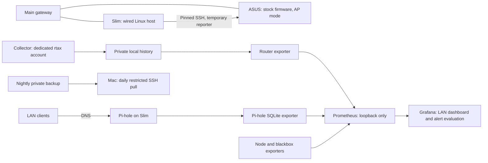

# Slim deployment record — 2026-10-17

Slim is an HP t630 (AMD GX-420GI, 6.7 GiB RAM, approximately 30 GiB disk)
running Ubuntu 24.04 with Xfce. It is headless and wired to the main gateway.
The stock ASUS RT-AX56U operates as an access point on the same LAN.

## Architecture

This is device-health and service monitoring. It does not provide whole-network
packet capture, intrusion detection or IoT segmentation. An SSH collection incident
means telemetry is unavailable; it does not prove the router has failed.

## Evidence and its boundaries

| Evidence | Source | What it establishes |
| --- | --- | --- |
| Collector 1.6.0, reporter 1.0.5 deployed; 386 collector tests reported run on Slim | Claude deployment session, 17 October | Recorded commissioning result; not independently rerun by this documentation update |
| Collector started at 14:14; router exporter at 14:16 | Operator-supplied `systemctl status`, 18:34 AEST | Both were active and enabled at inspection |
| Latest sample logged at 18:33 | Same collector journal excerpt | Collection was producing samples about four hours after startup; not a complete audit of every intervening attempt |
| Pi-hole, Prometheus, node exporter, blackbox exporter, Grafana and both custom exporters active and enabled | Same service status output | Eight named services were running; running processes alone do not prove every probe or DNS response was healthy |
| Grafana scheduler received successful Prometheus responses | Same Grafana log excerpt | Queries were working at inspection; this does not establish every panel or alert rule's current state |
| 13 alert rules loaded and healthy; dashboard queries returned data | Claude deployment session | Earlier commissioning observation; not rechecked by the later status command |
| Backup archive dated 14:19; next timer activation 18 October at 03:36 | Operator-supplied directory listing and timer output | Archive exists and timer is scheduled; scheduled execution and restore have not yet been verified |
| First backup copied to Mac at 13:35 | Local Mac backup directory inspected during this update | One local copy exists; the 14:19 archive was not yet present on the Mac |
| Zero failed systemd units after rerunning wait-online | Operator-supplied follow-up output | The recorded boot timeout was cleared successfully |

At 18:34, root disk use was 44%, available RAM 5.6 GiB, swap use zero and load
average 0.00 / 0.01 / 0.00. These are point-in-time observations.
No raw household logs, databases or target identities are included here.

### Network startup diagnosis

The boot check timed out at 05:09:25. Ethernet gained carrier at 05:11:18 and
received its DHCP lease at 05:11:25. The generated wait-online unit explicitly
waited for Ethernet; it was not blocked on the disabled Wi-Fi interface.
Restarting the wait service after connectivity was established succeeded.
No network configuration change was required. This is not a controlled reboot test.

## Collector deployment

The source change originated as private-development commit `34b883a` on
`feature/key-auth`. This publication branch carries that patch without importing
private-development history. Deployed component versions are collector **1.6.0**, reporter
**1.0.5**, schema `router_health/2`; the historical project tag **v0.1.0** is unchanged. This publication branch also
contains undeployed collector **1.6.2**, including the 1.6.1 sample-directory sync
correction and a dedicated loop hard-stop exit code. Version 1.6.2 and its matching
service unit were then **pending deployment** (deployed 18 October 2026; see
[the 1.6.2 record](slim-collector-162-20261018.md)).

The collector runs under the unprivileged `rtax` account every 60 seconds. Its
private key is `/home/rtax/keys/id_ed25519`, with no password or agent fallback.
Pinned host-key and reporter-hash checks remain enforced. In the **1.6.2 repository
example**, exit 4 means a loop identity/artifact hard stop and exit 2 means bad
configuration; neither is restarted. Exit 1 covers other collection/CLI failures,
and exit 3 covers a held lock or storage error taking it; both are retried.
This code/unit pair was deployed on 18 October 2026.
The previous application directory was retained during commissioning for rollback.

At **21:58 AEST on 17 October**, the owner reported two live corrections, backed
up under `/var/backups/slim-manual/20261017-215821/`: Pi-hole panel 8 uses
`probe_dns_duration_seconds{job="dns_pihole",phase="request"}` with legend
`Pi-hole answer`, and the deployed **1.6.0** unit uses `RestartPreventExitStatus=1 2`.
That interim unit retries exit 3 but still blocks exit 1 because 1.6.0 uses it for
identity/artifact hard stops as well as other failures. The repository dashboard
matches the reported correction. Its newer `4 2` unit must be deployed together
with collector 1.6.2. These are owner-reported changes, not a new live verification
by this documentation update.

The ASUS web form initially saved a truncated public key. A complete key was
installed through the operator's authenticated router session, and key login then
worked. This is a commissioning issue, not an instruction to publish router keys.

## Monitoring and backup scope

Prometheus and the four exporters listen on loopback. Grafana and the Pi-hole
administration page are reachable from the LAN, with host firewall restrictions.
Remote desktop is a separately configured LAN service and is not part of the eight
service check above. Pi-hole statistics come from read-only SQLite connections;
query records can lag live traffic by the configured database flush interval.

The alert set covers DNS, gateway/AP reachability, internet probes, host disk and
memory, backup age, blocklist age, scrape failures, stale collection, collection
incidents, router reboot identity and router memory. **Telegram delivery remains
pending.** Rules evaluating successfully does not establish notification delivery.
An external uptime check is also pending: Slim cannot report its own total outage.

The timer starts backups after 03:30 with up to 15 minutes of random delay and
keeps 14 archives. A Mac launchd job pulls daily at 09:00 and keeps 30. Archives
include private Pi-hole/Grafana data and configuration, collector state and pinned
artifacts, scripts and service units. They exclude Prometheus history and the
collector private key at `/home/rtax/keys/id_ed25519`. Its exclusion depends on
keeping it outside the archived `/home/rtax/data` and `/home/rtax/pinned` trees;
there is no filename-based private-key exclusion. Archives are private recovery
material, not publication assets.
The backup script's optional config archive tolerates read failures; an archive and
success timestamp alone do not prove completeness. See the [recovery runbook](slim-operations.md).

## Remaining validation

- Fresh functional checks of DNS, all scrape targets, probes and Grafana rule states.
- First scheduled nightly backup and subsequent Mac pull of that archive.
- A restore rehearsal on an isolated destination, including regenerating router access.
- Controlled host/router reboot, power-loss recovery and longer collection review.
- Telegram test delivery and an independently hosted outage check.
- Confirmation of BIOS power-on-after-power-loss configuration.

[Deployment examples](../deploy/slim/README.md) record the recovered configuration
and source provenance. They are sanitized references, not a fresh export of every
live file or an automatically validated installer.
