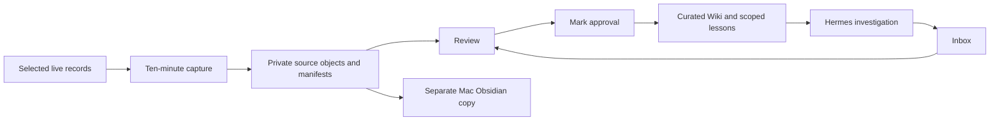

# Slim telemetry vault — 20 October 2026

## Request and architecture

Mark requested a separate Slim/telemetry Obsidian vault following the existing Mac
Voltron architecture, then authorized adding the implementation to Git. He also
asked to assess the Herbert Tipping and Venture Studio learning capabilities.

Reviewed sources: Voltron SYSTEM/SCHEMA, medallion architecture, documentation
system, learning-loop README and operational references; installed studio skills
and reminders; live Slim schedules, retention and backup selection.

The resulting architecture separates captured sources, review proposals and curated
knowledge. Chat and a model's explanation are not authoritative incident records.

## Deployment observations

- An initial private snapshot preserved currently available records before further
  source pruning. No earlier deleted history was recovered.
- The first capture at 16:20 AEST preserved 1,512 changed sources and explicitly
  reported three cron SQLite open failures under read-only home protection.
- A narrow service exception for SQLite WAL coordination corrected those failures.
  The 16:22 capture reported 12 changed sources, no errors and approximately 5 MiB
  of raw archive storage. The timer was enabled.
- The first Mac pull succeeded with a fresh capture receipt and no source errors.
- The vault is registered as a separate `slim-telemetry` Obsidian vault. It does not
  rename or write into the existing Voltron vault.

These are installation observations, not an endurance or general reliability claim.
The private backup paths, manifests and source contents remain outside Git.

## Learning reuse

The existing studio implementation supplies useful source-citation checks, bounded
retrieval, outcome records, independent-review requirements, expiry, Raw/Review
exports and experiment comparisons. A fresh Slim-only register reuses those
mechanisms, with operational metrics added. Studio product rules and private
evidence were not transferred.

The inspected studio register had six exposure receipts, fourteen recorded passes
and zero independently reviewed passes. This does not demonstrate causal improvement.
Slim begins with no lessons and no measured gains. Its startup/closeout workflow is
instructed, not enforced by the studios' Kanban hook. No paid evaluation, model call,
correction-scoring watcher or autonomous network reconfiguration was installed.

## Acceptance and remaining validation

Focused tests cover retained evidence after source deletion, changed-source history,
deduplication, corruption, quota refusal without pruning, explicit failed sources,
SQLite WAL snapshots, mirror transfer failures and stale-status handling. Learning
tests cover false promotion, independence, expiry, stale proposals and operational
metric bounds. Counts and final live verification are recorded in the closeout below.

First 24-hour check: 21 October. First full seven-day archive review: 27 October,
measured from archive creation rather than retroactively from service deployment.
Longer capture gaps, archive growth, alert delivery and restore readiness remain
subjects for that review.

See [tooling and runbook](../deploy/slim-vault/README.md) for scope, limitations,
installation and rollback.

## Closeout checks

- `make test`: **146 tests run**, **17 skipped**, no failures (104 existing deployment tests, 12 vault/mirror tests, 24 learning tests, 6 repository scripts tests).
- Live Slim verification: **1,543 archived objects** passed their SHA-256 check at that point; capture service result was success and exit status zero.
- Mac copy verification: the same **1,543 objects** passed their hashes. A conversation-database snapshot was restored into a temporary private file and passed SQLite `quick_check`. The temporary restore was removed.
- The Mac mirror receipt reported no capture errors and a fresh capture. A detached ten-minute mirror runner was started for the initial eight-day period; it does not survive Mac reboot.
- The native Slim learning report showed an empty register and no measured gains. No synthetic tests were recorded as real learning outcomes.

These checks demonstrate the tested mechanisms and first copies only. They do not establish a complete week of archive coverage, disaster recovery of the whole host, successful independent lesson promotion or improved network performance.
